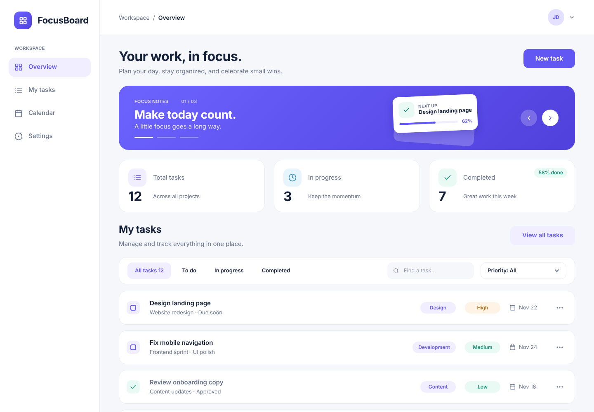
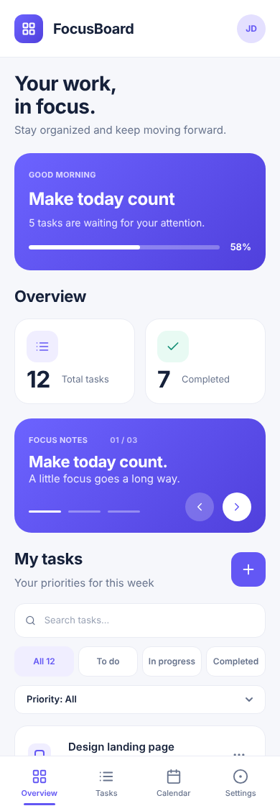

# FocusBoard

A responsive task dashboard built with **React + Vite + JavaScript + CSS** (frontend only, no backend).

- **Live app:** _add your Vercel/Netlify HTTPS URL_
- **Repository:** _add your GitHub URL_

 

## Features
Create / edit (same form) / delete with confirmation · status updates (To do, In progress, Completed) · case-insensitive title search · status tabs + priority filter working together · live statistics and completion % · three-slide Focus Notes carousel (prev/next, dots, direct select) · localStorage persistence · responsive at 390 / 768 / 1440 px · keyboard-accessible with labelled controls.

## Tech stack
React 18, Vite, Lucide React (icons), plain CSS with design tokens, localStorage.

## Run locally
```bash
npm install
npm run dev      # development
npm run build    # production build in dist/
```

## Structure
`src/components` (UI), `src/hooks/useLocalStorage.js`, `src/utils/taskUtils.js` (stats + filtering), `src/data/sampleTasks.js`.

## State management
React hooks only. `App` owns one `tasks` array (via a `useLocalStorage` hook) and passes it down as props, so cards, stats, filters and the form always agree.
- **Mutations** use `map` / `filter` / spread, returning new arrays (no direct mutation).
- **Derived values** (stats, filtered list, tab counts) are computed with `useMemo` from `tasks` and are never stored.
- **Persistence:** saved data under `focusboard_tasks` is loaded first; the six sample tasks are used only when nothing is saved. Invalid JSON falls back safely.
- **Carousel:** `FocusNotes` keeps the active index in `useState`; slide, counter and dots all read it. Navigation is circular.

## Figma notes and deviations
Built from the supplied Figma frames (desktop 1440, mobile 390, form 760, three carousel slides).
Small additions needed to meet the assignment requirements:
- A **To do** tab, and the priority filter on mobile (Figma shows only All / In progress / Completed there).
- A "% done" badge on the Completed card, so the completion percentage is visible on desktop (Figma shows it only in the mobile hero).
- On mobile the Focus Notes carousel sits below the Overview cards (Figma's mobile frame shows only the greeting card). To hide it there, add `.focus { display: none }` inside the 768px media query.
- Status changes and Edit / Delete live in each row's "..." menu; the leading tile toggles Completed.
- The form has no category field (as in Figma); new tasks get the category "General".

## Limitations
- Sidebar and bottom-nav items other than Overview, and the profile menu, are visual placeholders.
- The native date input shows the browser's locale format instead of "DD / MM / YYYY".
